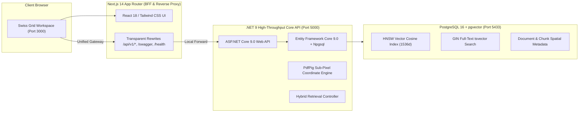

# VERITAS // CORPUS

> **Visual Grounded Deep Research AI Platform (NotebookLM + Perplexity Hybrid)**  
> *Deterministic Sub-Pixel PDF Bounding Box Verification with Dual-Engine Architecture (.NET 9 + Next.js 14).*

[](https://github.com)
[-blue?style=flat-square)](https://dotnet.microsoft.com)
[](https://nextjs.org)
[](https://github.com/pgvector/pgvector)
[](https://playwright.dev)
[]()
[](LICENSE)

---

## 📌 Executive Overview

Current research AI assistants frequently hallucinate citations, point to incorrect pages, or reference entire documents without verifiable spatial provenance.

**VERITAS // CORPUS** solves the grounding crisis in deep research. Every claim, sentence, and technical metric synthesized by the AI is mathematically grounded to exact PDF page numbers and normalized bounding boxes (`{x, y, w, h}`). Clicking any citation instantly navigates the natural paper evidence canvas and snaps an amber optical reticle directly over the source text.

```
+-----------------------------------------------------------------------------------+
|                            VERITAS // CORPUS WORKSPACE                            |
+------------------------+-------------------------------+--------------------------+
|  DOCUMENT SIDEBAR      |  RESEARCH STREAM              |  EVIDENCE CANVAS         |
|  - Ingested Sources    |  - Query Synthesis            |  - Natural Paper #F8F7F4 |
|  - Hybrid RRF Slider   |  - Citations [1], [2], [3]    |  - Optical Reticle Snap  |
|  - Candidate Top-k     |  - Retrieval Trace (BM25/vec) |  - Sub-Pixel BBox Focus  |
+------------------------+-------------------------------+--------------------------+
|                     Unified Gateway: http://localhost:3000                        |
+-----------------------------------------------------------------------------------+
```

---

## 🏗️ Architecture & Dual-Engine Model

VERITAS utilizes a high-throughput **Dual-Engine** design to separate heavy ingestion and spatial parsing from dynamic streaming UI:



1. **Next.js 14 App Router (Port 3000):**  
   - Serves the Swiss Grid 3-pane research environment.
   - Provides smooth 150ms optical reticle animations and deterministic canvas navigation.
   - Functions as a transparent reverse proxy gateway so all requests (`/`, `/api/v1/*`, `/swagger`, `/health`) share a single origin.

2. **C# .NET 9 Core Web API (`Veritas.Core.Api`):**  
   - Built on the latest **.NET 9 (C# 13)** runtime for maximum throughput and memory efficiency.
   - Handles multi-gigabyte document ingestion, chunking, and PDF stream parsing with `PdfPig`.
   - Uses `Npgsql.EntityFrameworkCore.PostgreSQL` and `Pgvector.EntityFrameworkCore` for vector similarity and metadata queries.

3. **PostgreSQL 16 + pgvector:**  
   - Dedicated pgvector container with HNSW cosine distance indexing (`vector_cosine_ops`).
   - Integrated full-text search with English `tsvector` and GIN index.

---

## ✨ Key Capabilities

### 1. Spatial Grounding & Optical Reticle Lock
- Citations in the AI response (`[1]`, `[2]`, `[3]`) are interactive triggers.
- Clicking a citation smoothly scrolls the PDF canvas (`#F8F7F4` paper) to the precise sentence and locks an amber optical reticle (`#F59E0B`) around its bounding box coordinates (`Y: 280.1, X: 48.0, W: 540`).

### 2. Hybrid Retrieval with Reciprocal Rank Fusion (RRF)
- Combines semantic vector proximity with lexical keyword accuracy using reciprocal rank fusion:
  $$Score_{RRF}(d) = w_{dense} \cdot \frac{1}{60 + R_{dense}(d)} + w_{sparse} \cdot \frac{1}{60 + R_{sparse}(d)}$$
- Dynamic UI slider gives researchers real-time control over dense vs. sparse weighting.

### 3. Strict Anti-AI Engineering Design (Swiss Grid)
- **Zero generic AI tropes:** No neon purple/pink gradients, no glassmorphism backdrop blur, no whimsical pulse animations, and no bubbly rounded corners.
- Crisp 1px hairline borders (`#222226`), deep obsidian background (`#09090B`), and typographic hierarchy rooted in `IBM Plex Sans` and `IBM Plex Mono`.

### 4. Enterprise Security & Hardening
- **Strict Headers:** `X-Frame-Options: DENY`, `X-Content-Type-Options: nosniff`, `Referrer-Policy: strict-origin`, `X-Powered-By` suppressed.
- **SQL Injection Prevention:** 100% parameterized LINQ queries through EF Core 9.
- **Single-Origin Gateway:** Zero CORS exposure during demonstrations or production rollouts.

### 5. Deterministic Sub-Pixel Coordinate Engine (PdfPig + XY-Cut)
- Real-time single & multi-document batch ingestion (`POST /api/v1/documents/upload` & `/upload-batch` up to 25 files / 120MB per file) with indexed **SHA-256 deduplication** (`idx_documents_checksum`).
- **Binary & Security Validation (`IngestionValidationService`):** Verifies `%PDF-` magic-byte headers (`INVALID_PDF_HEADER`), blocks active PDF script triggers (`/JavaScript`, `/JS`, `/Launch`, `/SubmitForm`, `/ImportData` -> `SECURITY_ACTIVE_CONTENT_BLOCKED`), detects scanned/low-text PDFs (`< 50` chars -> `ocr_required`), and sanitizes control characters.
- **Multi-Column XY-Cut Reading Order:** Recursively separates full-width headers from multi-column prose gutters without interleaving columns or shattering narrow table rows.
- **Character Offset Mapping & Line BBoxes:** Computes exact monotonic `charStartIndex..charEndIndex` spans, sentence-boundary chunks, and line-level normalized `LineBoundingBox` arrays.
- Converts 72 DPI bottom-left origin PDF coordinates into normalized DOM viewport coordinates $[0.0 .. 1.0]$:
  $$normX = \frac{x_{pdf}}{W}, \quad normY = \frac{H - y_{top}}{H}, \quad normW = \frac{w}{W}, \quad normH = \frac{h}{H}$$
- **Normalized Coordinate Caching:** .NET 9 `IMemoryCache` version-token cache (`CoordinateCacheService`) serving pre-normalized page coordinates with `X-Coordinate-Cache: HIT|MISS` headers in `< 1ms`.

### 6. Cloud-Resilient Runtime, `pdfjs-dist` Parity & Multi-Stage Docker
- **Smart Gateway & Cloud Parity:** Next.js Route Handlers (`/health`, `/api/v1/documents/...`) dynamically detect backend state—proxying to .NET 9 locally, and using an integrated **Node.js `pdfjs-dist` XY-Cut parser + persistent cloud store** when `.NET 9` is in standby (`ocaq.dev`), keeping `Flow`, `Spatial BBox`, `Upload`, and `Corpus` inspection 100% functional.
- **Multi-Stage Dockerfile:** Production container packaging .NET 9 SDK publish, Next.js 14 build, and unified Debian runner with `supervisord`.
- **Stitch Optical Branding:** Precision reticle icon mark and 64x64 vector favicon.

---

## 🚀 Quick Start Guide

### Prerequisites
- **Node.js:** v18.18+ or v20+
- **.NET SDK:** 9.0+ (`dotnet --version`)
- **Docker Desktop:** Installed and running

### 1. Clone & Install Dependencies
```bash
git clone https://github.com/your-username/veritas-corpus.git
cd veritas-corpus
npm install
```

### 2. Start PostgreSQL with pgvector
```bash
docker compose up -d
```
*PostgreSQL with pgvector will be healthy on host port `localhost:5433`.*

### 3. Initialize & Seed Database
```bash
# Push schema tables (documents, document_chunks) and vector indexes
npm run db:push

# Seed initial research document with verified spatial bounding boxes
npm run db:seed
```

### 4. Build .NET 9 Backend
```bash
dotnet build backend/Veritas.slnx
```

### 5. Launch Both Engines Concurrently
```bash
npm run dev:all
```
*This command starts both Next.js 14 and ASP.NET Core 9 concurrently.*

---

## 🌐 Unified Access Endpoints

Everything is routed through the single unified gateway:

| Target Surface | URL | Description |
| :--- | :--- | :--- |
| **Workspace UI** | [http://localhost:3000](http://localhost:3000) | 3-Pane Swiss Grid Deep Research Canvas |
| **API Swagger UI** | [http://localhost:3000/swagger](http://localhost:3000/swagger) | Interactive OpenAPI / Swagger Documentation |
| **Documents API** | [http://localhost:3000/api/v1/documents](http://localhost:3000/api/v1/documents) | Document collection, lookup & deletion (`DELETE /{id}`) |
| **Batch Ingestion API** | `POST /api/v1/documents/upload-batch` | Multi-file upload, SHA-256 dedup, security & OCR checks |
| **Document Summary** | [http://localhost:3000/api/v1/documents/summary](http://localhost:3000/api/v1/documents/summary) | Corpus stats (chunks, XY-Cut columns, char spans) |
| **Coordinates Cache API** | [http://localhost:3000/api/v1/documents/{id}/coordinates](http://localhost:3000/api/v1/documents/{id}/coordinates) | Cached normalized BBoxes, line BBoxes & char offsets |
| **Chunks API** | [http://localhost:3000/api/v1/documents/{id}/chunks](http://localhost:3000/api/v1/documents/{id}/chunks) | Spatial bounding box chunks & text offsets |
| **Reparse API** | `POST /api/v1/documents/{id}/reparse` | Re-run XY-Cut layout parsing & warm coordinate cache |
| **Health Check** | [http://localhost:3000/health](http://localhost:3000/health) | .NET 9 runtime & database telemetry |

---

## 🧪 Testing & Verification

### End-to-End Tests (Playwright)
```bash
# Run headless E2E verification
npm run test:e2e

# Run with interactive UI
npx playwright test --ui
```

### Backend Verification
```bash
# Verify .NET solution compiles with 0 errors / 0 warnings
dotnet build backend/Veritas.slnx

# Query health probe
curl http://localhost:3000/health
```

---

## 📁 Repository Structure

```
veritas/
├── backend/                              # C# .NET 9 Enterprise Core API
│   ├── Veritas.slnx                      # Modern .NET 9 Solution File
│   └── src/
│       ├── Veritas.Core.Domain/          # Domain Entities, Interfaces & pgvector types
│       ├── Veritas.Core.Infrastructure/  # EF Core 9, PdfPig XY-Cut, CoordinateCache & Validation Services
│       └── Veritas.Core.Api/             # ASP.NET Core 9 Controllers, Swagger, Program.cs
├── src/                                  # Next.js 14 App Router Frontend
│   ├── app/                              # Layout, Page, Route Handlers (/api/v1, /health)
│   ├── components/workspace/             # Swiss Grid Components (AppChrome, Canvas, CorpusView, Sidebar)
│   ├── lib/                              # Cloud Parity & Batch Engines (node-pdf-parser, cloud-ingestion, cloud-store)
│   ├── types/                            # Shared TypeScript Contracts (DocumentChunkDto, CoordinateCacheDto)
│   └── db/                               # Drizzle ORM Schema & TypeScript Seeder
├── public/                               # Static Brand Assets (Stitch Brandmark & SVG Favicon)
├── e2e/                                  # Playwright End-to-End Test Suite
├── docker-compose.yml                    # PostgreSQL 16 + pgvector Container Config
├── Dockerfile                            # Production Multi-Stage Container (.NET 9 + Node 20)
├── next.config.mjs                       # Next.js Reverse Proxy & Security Headers
├── package.json                          # NPM Scripts & Dependencies
├── PROJECT_RULES.md                      # Architecture & Design Standards
└── README.md                             # Repository Documentation
```

---

## 🗓️ 6-Week Roadmap

- [ ] **Week 1: Foundational Ingestion & Dual-Engine Infrastructure**
  - [x] Day 1: .NET 9 API, PostgreSQL pgvector, Next.js Swiss Grid UI, unified gateway.
  - [x] Day 2: Real PDF upload pipeline (`POST /api/v1/documents/upload`), `PdfPig` sub-pixel spatial parsing, normalized BBox coordinate engine, ocaq.dev cloud route handlers & fallback, Stitch brandmark & reticle favicon integration.
  - [x] Day 3: Character offset mapping (`charStartIndex`, `charEndIndex`), multi-column XY-Cut reading order, normalized coordinate caching (`IMemoryCache` + `Flow`/`Spatial BBox` canvas + `Corpus` Coordinate Inspector + Node `pdfjs-dist` cloud parity).
  - [x] Day 4: Multi-document ingestion batching & validation (`POST /api/v1/documents/upload-batch`, SHA-256 deduplication, `%PDF-` magic-byte & active-script blocking, OCR density detection, `DELETE` endpoint, and multi-file Batch UI).
  - [ ] Day 5: Optical reticle zoom mechanics, responsive UI (Mobile/Tablet), & Week 1 milestone freeze.
- [ ] **Week 2: Spatial Parsing & Bounding Box Normalization Engine**
- [ ] **Week 3: Hybrid Retrieval & Reciprocal Rank Fusion (RRF)**
- [ ] **Week 4: Grounded Synthesis & Interactive Streaming**
- [ ] **Week 5: Corpus Management & Visual Coordinate Inspector**
- [ ] **Week 6: Grounding Benchmarks, Hardening & Production Release**

---

## 📄 License

This project is licensed under the [MIT License](LICENSE).
